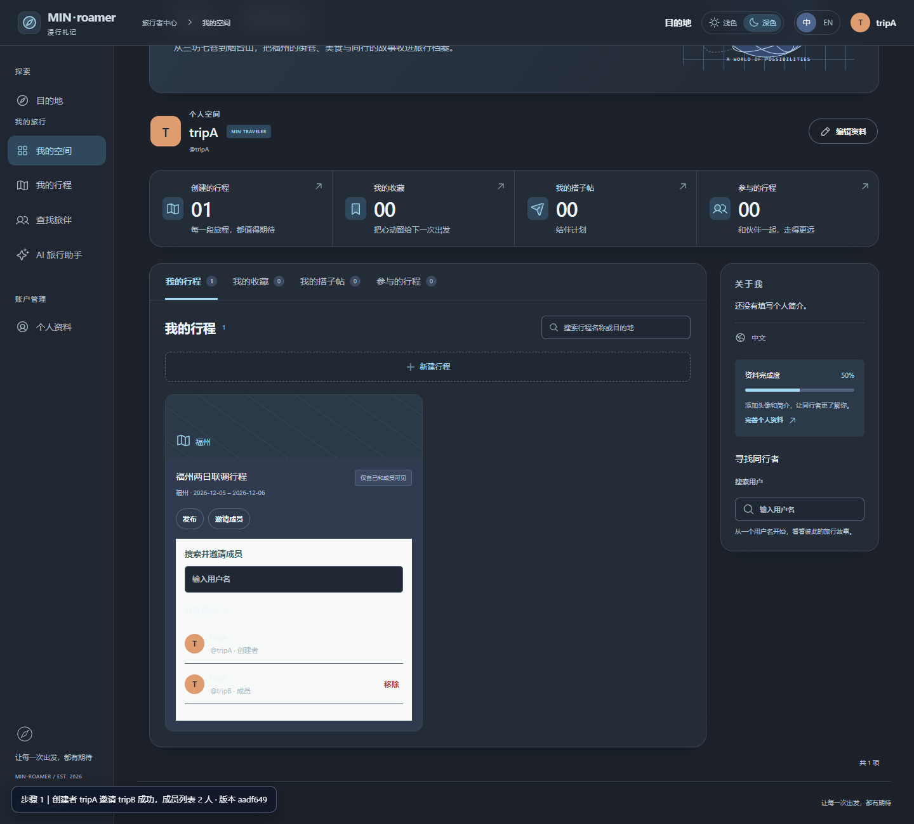
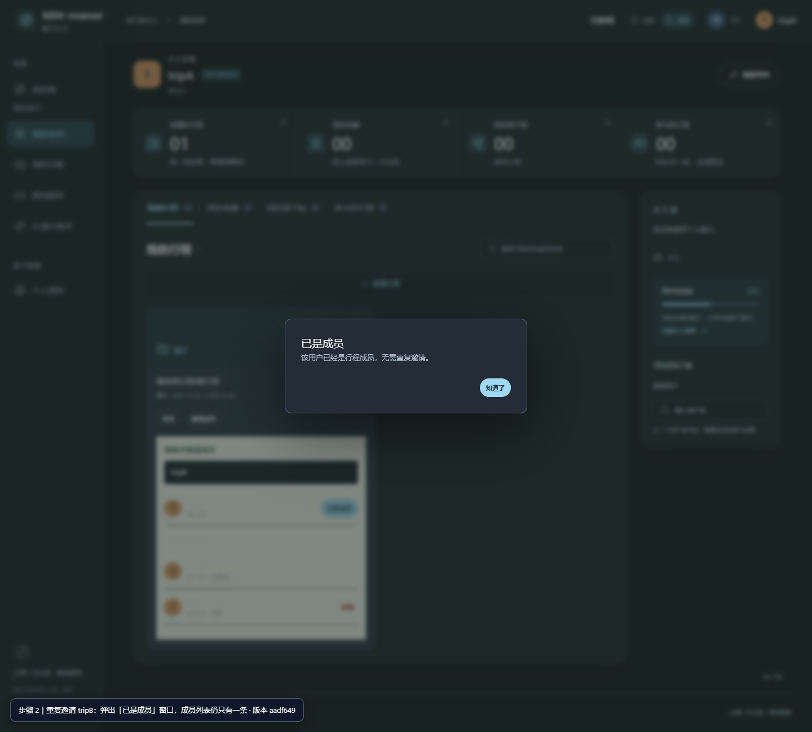
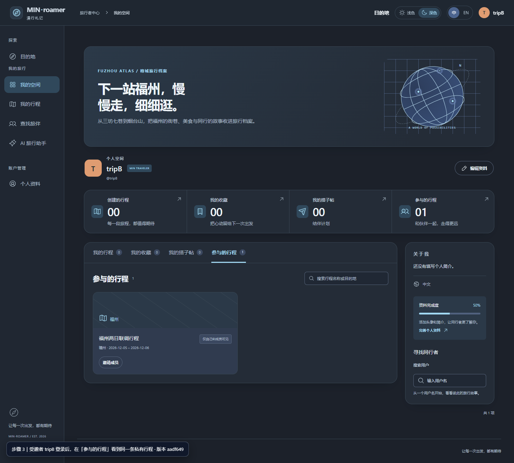
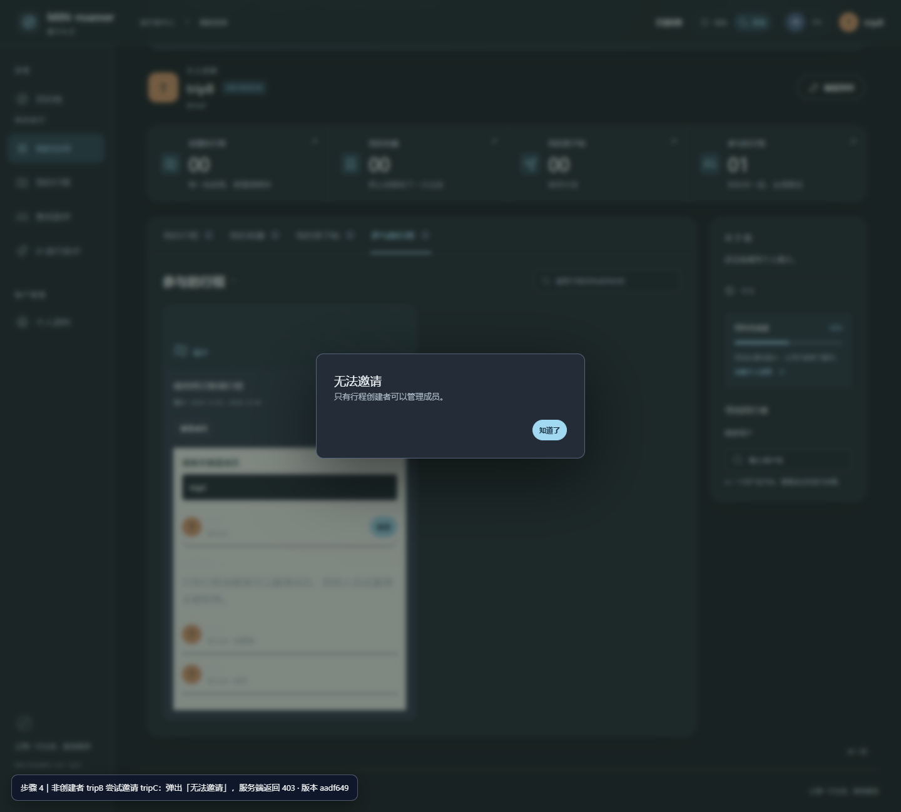
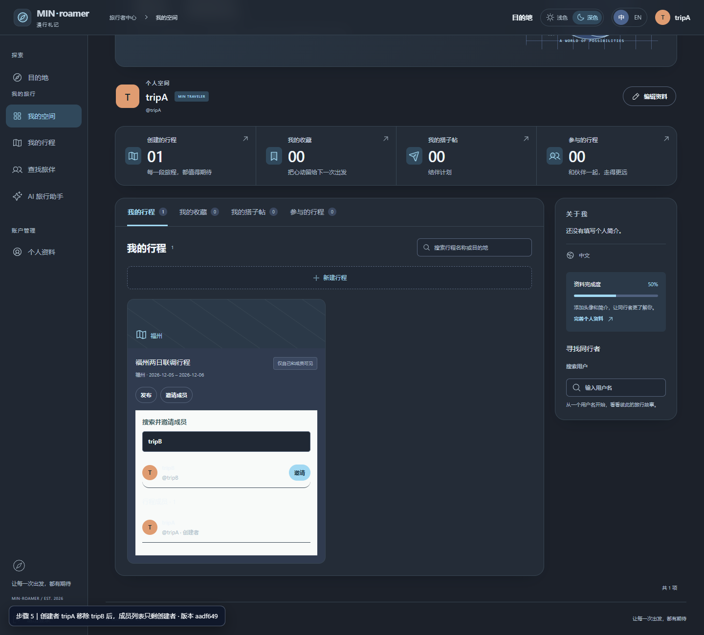
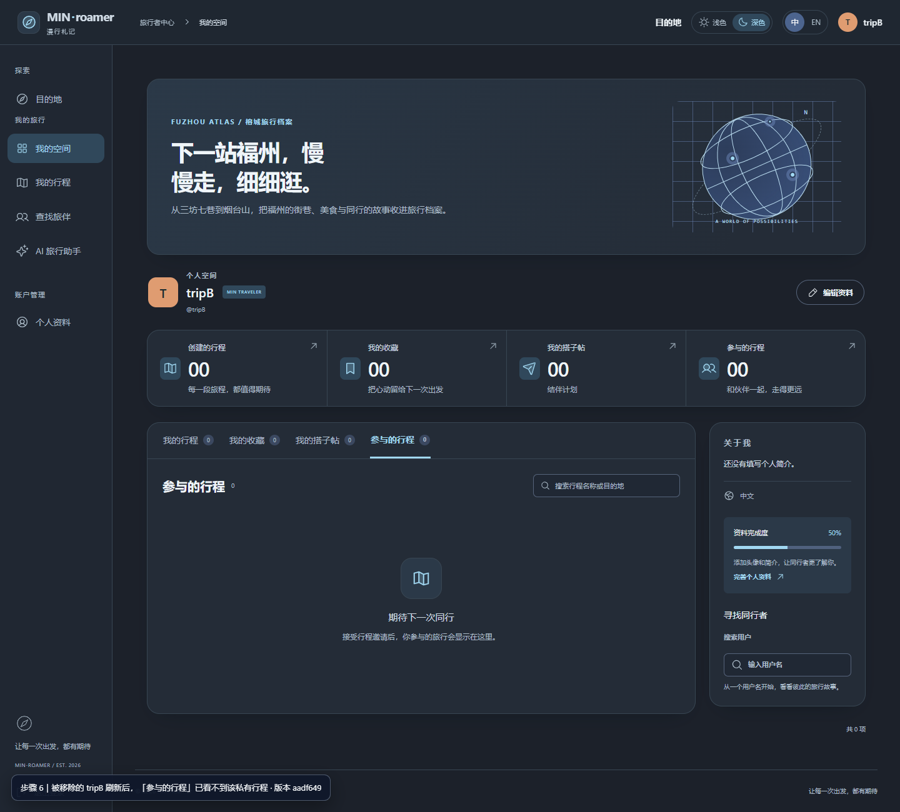

# E 组 · Issue #18 邀请 / 成员可见性 / 权限联调证据

- **被测版本**：分支 `feat/e-invite-flow` @ **`aadf649`**（基于 `main` @ `3f20d1c`）
- **被测时间**：2026-11-24 20:20–20:23（本地真实运行，非 mock）
- **测试账号**：`tripA`（创建者）、`tripB`（受邀者）、`tripC`（第三人）
- **后端**：Spring Boot 3.3.5 + H2 file，`http://localhost:8080/api/v1`
- **前端**：Vite 5.4 + React，`http://localhost:5173`（`/api` 代理到 8080）
- **浏览器**：Edge headless 1440×1300（Playwright）
- **用例脚本**：`capture-issue18.cjs`（本地脚本，未入库）

## 一、结论

| 验收项（Issue #18） | 结果 | 证据 |
| --- | --- | --- |
| 创建者邀请成功，受邀者登录后看到同一行程 | ✅ 通过 | 16（创建者成员列表 2 人）、18（受邀者「参与的行程」同一私有行程） |
| 重复邀请提示「已是成员」，成员列表只有一条 | ✅ 通过 | 17（弹窗「已是成员」，列表仍只有一条） |
| 非创建者尝试邀请被拒绝（403），截图 | ✅ 通过 | 19（前端弹窗「无法邀请」，接口 403） |
| 移除成员后，对方刷新看不到该私有行程 | ✅ 通过 | 20（移除后只剩创建者）、21（受邀者刷新后为 0） |
| 每一步一张截图，注明版本 SHA | ✅ 已备 | 16–21，文件名含 `1124-aadf649` |

## 二、截图

### 16 创建者 tripA 邀请 tripB 成功（成员列表 2 人）



### 17 重复邀请 tripB：弹窗「已是成员」，成员列表仍只有一条



### 18 受邀者 tripB 登录后看到同一私有行程



### 19 非创建者 tripB 邀请 tripC：弹窗「无法邀请」，服务端 403



### 20 创建者移除 tripB 后，成员列表只剩创建者



### 21 被移除的 tripB 刷新后看不到该行程



## 三、接口返回示例

创建者邀请（200）：

```http
POST /api/v1/trips/{tripId}/members
Authorization: Bearer <tripA-token>
Content-Type: application/json

{"username":"tripB"}

HTTP/1.1 200 OK
{"code":0,"message":"success","data":{"id":16,"ownerId":1,"title":"福州两日联调行程","isPublic":false,...}}
```

重复邀请（409，前端已先拦截并弹窗）：

```http
HTTP/1.1 409 Conflict
{"code":409,"message":"User is already a trip member","data":null}
```

非创建者邀请（403，前端弹窗「无法邀请」）：

```http
POST /api/v1/trips/{tripId}/members
Authorization: Bearer <tripB-token>

{"username":"tripC"}

HTTP/1.1 403 Forbidden
{"code":403,"message":"Only the trip owner can do this","data":null}
```

移除成员（200）：

```http
DELETE /api/v1/trips/members/{memberId}
Authorization: Bearer <tripA-token>

HTTP/1.1 200 OK
{"code":0,"message":"success","data":null}
```

被移除者的行程列表与成员列表：

```http
GET /api/v1/trips/mine
Authorization: Bearer <tripB-token>

HTTP/1.1 200 OK
{"code":0,"message":"success","data":[]}

GET /api/v1/trips/{tripId}/members
Authorization: Bearer <tripB-token>

HTTP/1.1 404 Not Found
{"code":404,"message":"Trip not found","data":null}
```

## 四、复测步骤

1. `cd backend && mvn spring-boot:run`（`JWT_SECRET` 由 `scripts/Start-Local.ps1` 注入）
2. `cd frontend && npm run dev -- --host 127.0.0.1 --port 5173`
3. `tripA` 登录 → 我的空间 → 行程「邀请成员」→ 邀请 `tripB`（图 16）
4. 再搜索 `tripB` → 点「已是成员」→ 弹窗（图 17）
5. `tripB` 登录 →「参与的行程」看到同一行程（图 18）
6. `tripB` 打开「邀请成员」→ 邀请 `tripC` → 弹窗「无法邀请」，接口 403（图 19）
7. `tripA` 移除 `tripB`（图 20）；`tripB` 刷新后列表为空（图 21）

## 五、已知限制

- 行程成员可以打开「邀请成员」面板查看成员，但只有创建者能实际邀请/移除；非创建者的邀请由前端弹窗提示、后端 403 兜底。
- 移除成员后没有实时推送，对方需要刷新页面才会消失（符合验收口径「刷新后看不到」）。
- 重复邀请在前端即拦截（弹窗），后端仍以 409 兜底，用于并发/多标签页场景。

## 六、本次改动

- `frontend/src/pages/MyHomePage.tsx`：成员也能看到「邀请成员」入口；重复邀请、409、403 统一走提示弹窗；非创建者不显示「移除」并显示权限说明。
- `frontend/src/components/NoticeDialog.tsx`（新增）：单按钮提示弹窗（原生 `<dialog>`）。
- `frontend/src/account-translations.ts`：邀请相关中英文文案（不改公共 `i18n.ts`）。
- `backend/src/test/java/com/minroamer/trip/TripInviteTest.java`（新增）：4 个回归用例（邀请成功 / 重复 409 / 非创建者 403 / 移除后失联）。

## 七、自测结果

```text
backend: mvn -B -o test
  Tests run: 60, Failures: 0, Errors: 0, Skipped: 0   BUILD SUCCESS
  （含 TripInviteTest 4/4）

frontend: npm run lint   → 通过
frontend: npm run build  → tsc -b && vite build 成功
```
